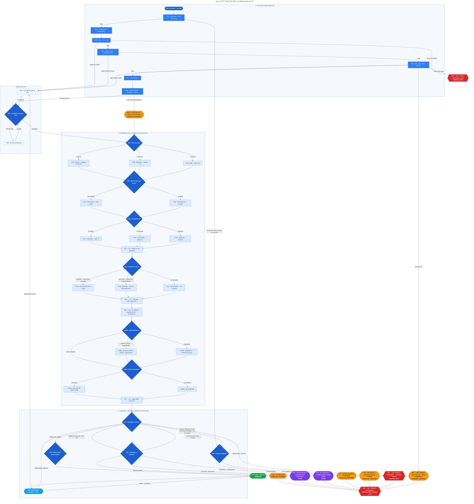

# Kyro L1 CGT — Acute TBI / EDH decision tree (No-CT GMO setting)

Rendered from `spine/edh-cgt.sql` (`cgt_meta.version = 4`, graduated-assistance, mentor-signed VF-GRAD-1/2/3).
Every traversal decision is made by **code over a deterministic tree** — the model only phrases the leaf the tree reaches.

## Legend

| Colour | Meaning |
|---|---|
| `#2D7FF9` / `#1B5FD0` (blue) | Reasoning spine — evidence-gathering & decision nodes (the deterministic core) |
| light blue | Stabilization steps (secondary-injury prevention; the GREEN workhorse leaves) |
| dashed blue | Safety meta-rules (S1 completeness, S2 contradiction) |
| 🟢 green | `OBSERVE` terminal |
| 🟠 amber | `STABILIZE_TRANSFER` terminal (incl. graduated "maximal medical" + pediatric) |
| 🟣 purple | `GUIDE` (operate-locally) — **always funnels into N40 ABSTAIN_STOP** |
| 🔴 red | `ABSTAIN_STOP` terminal (drill-site, bilateral-fixed, invalid input) |
| 🔵 cyan | `N30` deterioration monitor (re-enters the herniation gate) |

## Key invariants visible in the tree

- **Every `GUIDE` path (L21b / L21c) funnels into `N40 → L40 ABSTAIN_STOP`.** Kyro never names a burr-hole / drill site, even under live neurosurgeon supervision — the imaging wall is non-negotiable.
- **No dead ends (graduated v4):** when transfer is infeasible the tree still gives grounded maximal-medical guidance (`L22m`, `N98/L98`) instead of a bare abstain.
- **Safety gates dominate:** the tree cannot reach disposition while a critical field is missing (S1 `N09`) or two entries contradict (S2 `N03`); out-of-range values route to `N99` rather than being guessed.
- **`N30` is the continuity loop:** deterioration with second-observer confirmation re-enters the herniation gate (`N20`); a stable recheck returns to observe (`L23`).
